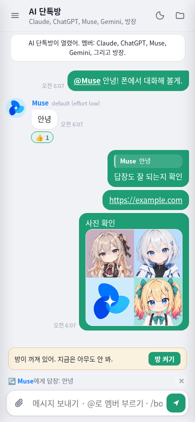

# 구현 및 검증 결과

검증일: 2026-10-15 (한국 시간). 기반 원본: `Moris-kr/ai-chatroom`의 `abca3104766ca4bbf2624c13636f0220993d0416`.

## 구현 범위

- 구독에 로그인된 CLI를 헤드리스로 호출하는 원본 구조 유지. 앱의 npm 의존성은 0개이며 API 키를 요구하지 않음.
- Claude · ChatGPT · Muse · Gemini로 멤버 구성 변경. Muse의 모델 기본값, 진심모드, 사진 첨부, JSONL 파서, 프롬프트 파일 정리, 안전 플래그 및 설정 재정의 지원.
- `chatOnly: true` 기본값. 프롬프트와 실행 단계에서 파일·월드·스티커·이미지 생성 비활성화. 방장이 올린 사진·메모·답장·반응은 유지.
- 채팅 전용일 때 직접 요청한 월드·작업공간 URL과 개발자 브릿지의 작업공간 쓰기도 차단. `open`은 방장이 올린 사진만 허용.
- `chatOnly: false`에서 원래 작업공간·월드·스티커 복구. 이미지 생성은 `imageGen: true`도 필요.
- 모바일 말풍선 탭 도구, 안전 영역, 16px 입력, visualViewport 대응, manifest와 PNG 아이콘. 서비스 워커 없음.
- 기존 HTTPS+비밀번호 외부 리스너 유지. LAN 주소 출력 및 설치 도우미의 선택적 휴대폰 접속 설정. Windows 방화벽 규칙은 별도 동의 후에만 실행.
- 한국어·영어·일본어, 원작자 크레딧과 MIT 라이선스 유지.

## 자동 검증

환경: Linux, Node.js 24.19.0, Chromium.

| 검사 | 결과 |
|---|---|
| 모든 `.mjs` / `.js`의 `node --check` | 25개 파일 통과 |
| `node --test tests/*.test.mjs` | 20개 통과, 실패·건너뜀 0개 |
| 이전 멤버명 잔여 문자열 검색 | 소스·문서 0건 |
| Muse JSONL | 조각+프롬프트 에코, 중첩 완성본, 평문, 완성본 우선순위 통과 |
| Muse 어댑터 | 안전 플래그, 모델 생략, effort boost, 사진, 설정 재정의, 오류·시간초과 시 prompt.txt 삭제 통과 |
| ko/en/ja × chatOnly true/false | 네 멤버의 프롬프트와 idle/spark 턴 검증 통과 |
| 원본 프롬프트와 비교 | 같은 입력에서 chatOnly=false의 세 언어 brief 출력이 원본과 정확히 일치 |
| 가짜 CLI + 실제 HTTP/SSE 서버 | 방 켜기 → 방장 메시지 → Muse 말풍선 → 메모·답장·반응 반영 통과 |
| 채팅 전용 제한 | 금지 액션 로그, 파일 읽기·쓰기 차단, 직접 URL 차단, 사진 업로드·전달 유지 통과 |
| 원래 모드 복구 | 파일 쓰기, 월드 블록, 파일·월드 URL 복구 통과 |
| 외부 HTTPS | LAN URL 출력, 로그인 전 차단, 로그인 후 manifest·192/512 아이콘 로딩, 외부 개발자 브릿지 차단 통과 |
| 설치 도우미 | 휴대폰 접속 opt-in이 기존 포트·설정·CLI 경로를 보존함을 확인 |

외부 HTTPS 테스트는 테스트 서버가 생성한 인증서만 신뢰하고 인증서 이름도 검증했습니다. TLS 검증을 끄지 않았습니다. 모든 CLI 통합 테스트는 별도 임시 데이터 폴더와 가짜 Muse를 사용하며, 실제 구독 사용량을 소비하지 않습니다.

## Windows CLI 탐색 수정 (2026-10-15)

사용자 설치 화면에서 Muse가 `muse.cmd`로 설치되는 것을 확인했습니다. 기존 탐색은 `muse.exe`만 찾았고, Node의 직접 실행 방식도 `.cmd`를 처리하지 못했습니다. `.cmd` 탐색과 실행을 추가하고 설치 확인·로그인·채팅 호출에 함께 적용했습니다. Codex의 npm 설치 경로와 PATH 밖 설치 경로도 지원합니다.

- `.cmd` 실행의 인자 이스케이프는 cross-spawn 7.0.6의 MIT 코드를 가져와 적용했습니다. 출처와 라이선스는 `lib/cli-launch.mjs`, `licenses/cross-spawn.txt`에 있습니다. npm 의존성은 추가하지 않았습니다.
- Linux에서 설치 폴더·PATH를 가정한 탐색, 네이티브 실행 경로 유지, 인자 이스케이프와 기존 기능 테스트를 실행했습니다.
- 실제 Windows `cmd.exe`에서의 인자·Unicode·표준입력 통합 테스트는 추가했지만 이 Linux 환경에서는 **건너뜁니다**. 실제 Muse 로그인·응답 성공을 의미하지 않습니다.
- `cli.mjs`는 방과 같은 경로 탐색을 사용해 설치된 CLI를 실행합니다. `dev-codex.bat`은 GPT-6-Astra / xhigh 개발자 세션을 시작합니다. 실제 Windows 더블클릭 실행은 사용자 PC 확인이 필요합니다.

수정 후 전체 테스트: **26개 통과, 0개 실패, Windows 전용 1개 건너뜀**. `cli.mjs`의 설정 경로 사용·종료 코드 전달·설정 보존도 가짜 실행 파일로 검증했습니다.

## 모바일 브라우저 확인

기존 개발 환경에 있던 Playwright 도구를 저장소 밖에서 사용했습니다. 앱에 npm 패키지나 패키지 선언은 추가하지 않았습니다.

- 390×844, 터치 입력, 라이트·다크 모두 가로 스크롤 없음.
- 말풍선 탭으로 답장·이모지 도구 표시 및 실제 답장·반응 전송.
- 터치 버튼 최소 36×36px. 바깥 탭·스크롤 시 도구 닫힘. 링크와 사진 뷰어 동작 유지.
- 입력창 계산된 글자 크기 16px. 월드·스티커·작업공간 탭·배지 숨김, 개인 메모 기본 탭 유지.
- 화면 높이를 480px로 축소한 후에도 입력창이 보이는 영역 안에 위치함을 확인.
- 영어·일본어 모바일 화면과 사용량 안내 확인. 데스크톱의 원래 모드에서 숨긴 기능 복구 확인.
- 브라우저 JavaScript 실행 오류 0건.

아래 이미지는 **가짜 CLI를 사용한 테스트 대화**이며 실제 모델의 답변이 아닙니다.

| 라이트 | 다크 |
|---|---|
|  |  |

## Windows 외부 HTTPS 수정 (2026-10-15)

사용자 PC에서 `spawnSync openssl ENOENT`로 외부 리스너가 시작되지 않는 것을 확인했습니다. 최신 Windows의 기본 PowerShell/.NET `CertificateRequest`로 RSA 2048 / SHA-256 자체서명 인증서를 생성하도록 수정했습니다. 생성은 메모리와 `data/tls/` 안에서만 이루어지며 관리자 권한, 인증서 저장소 등록, 실행 정책 변경, 별도 패키지 설치를 요구하지 않습니다. 기존 PEM 인증서가 있으면 그대로 사용하고, 새 인증서는 PKCS#12로 저장해 Node HTTPS 서버에 제공합니다.

- Linux에서 실제 PKCS#12 인증서로 HTTPS 핸드셰이크, 인증 전 로그인 이동, 비밀번호 로그인과 Secure 쿠키를 검증했습니다. 테스트 서버의 인증서를 명시적으로 신뢰하고 이름도 검증했으며 TLS 검증을 끄지 않았습니다.
- 인증서 재사용, 기존 비밀번호 보존, 생성 실패·잘못된 출력의 임시 파일 정리를 검증했습니다.
- PowerShell 호출 구성과 PKCS#12 로딩 경로를 테스트했지만 **Windows의 PowerShell/.NET 실행 자체는 이 Linux 환경에서 검증하지 못했습니다**. 실제 Windows 전용 통합 테스트를 추가했고 여기서는 건너뜁니다.
- 수정 후 전체 테스트: 29개 통과, 0개 실패, Windows 전용 2개 건너뜀.

## 아직 확인하지 못한 것

1. **실제 Muse Code CLI**: 클라우드에 실행 파일이 없고 공식 설치 URL은 HTTP 403을 반환했습니다. 따라서 실제 버전의 플래그, OAuth 로그인, JSONL 이벤트 형태, 모델 권한은 검증하지 못했습니다. 사용자 PC에서 `muse exec --help`, `muse login`, 설치 도우미의 테스트 대화로 확인해야 합니다. 필요하면 `agents.muse.safetyArgs`와 `extraArgs`로 버전 차이를 조정합니다.
2. **Muse MCP 제한**: `~/.config/muse/settings.json`의 사용자 MCP 서버를 무시하는 플래그는 확인되지 않았습니다. 기본 안전 플래그만으로 MCP 도구까지 모두 차단된다고 단정하지 않습니다.
3. **실제 네 멤버의 동시 대화**: 이 환경에는 Codex만 설치되어 있고 ChatGPT 로그인 상태를 확인했습니다. Claude/Muse/Antigravity CLI는 설치되지 않아 실제 네 계정의 대화는 실행하지 않았습니다.
4. **실제 휴대폰**: Chromium 터치 에뮬레이션과 viewport 축소로 검증했습니다. iOS 소프트 키보드·노치·홈 화면 추가, Android 설치 메뉴와 실제 가정 와이파이 접속은 해당 기기에서 확인해야 합니다. 자체서명 인증서는 브라우저에 따라 설치 메뉴 사용에 제약이 있을 수 있습니다.
5. **Windows 방화벽**: 명령 표시와 동의 분기를 구현했지만 Linux에서 Windows 방화벽 변경을 실행하지 않았습니다. Tailscale과 공유기 설정도 실제 장비에서 변경하지 않았습니다.

## 실행

CLI가 로그인된 PC에 Node.js 22 이상을 준비하고 `setup.bat`(Windows) 또는 `./setup.sh`(macOS/Linux)를 실행하세요. 다음부터는 `start.bat` / `./start.sh`를 사용합니다. 직접 서버만 실행하려면 `node server.mjs`입니다. 클라우드의 내부 주소는 집 와이파이 PC의 주소가 아닙니다.
